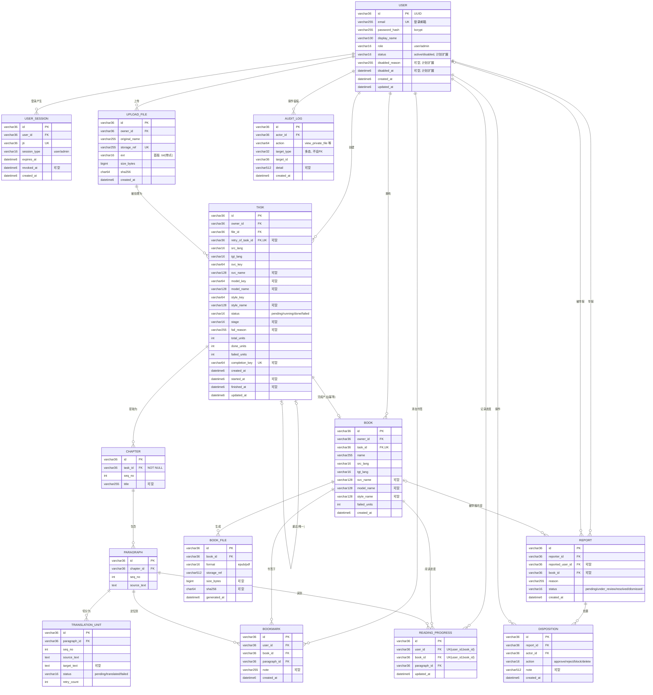

# ER 图（目标模型 · MySQL 8.4）

> 可编辑源文件（mermaid）：同目录 `01-er.mmd`（纯 mermaid，供本地工具导出）；本页 mermaid 代码块在 Gitee/GitHub 网页端可直接渲染。
> **SVG 已生成**：同目录 `er.svg`（全字段）与 `er-overview.svg`（关键字段概览），由 `scripts/render_database_er.py` 从 `schema.sql` 生成（纯 Python 标准库，不连库、不启动浏览器）。两图已与 `schema.sql` 逐表/逐列核对一致。
> 实现状态：`user`/`user_session` 已实现（`user.status/disabled_*` 为计划扩展列）；`upload_file`~`book_file` 本次拟定；`report`/`disposition`/`audit_log`/`bookmark`/`reading_progress` 为计划扩展（M2/M4 目标设计）。

## 总览

## 关系与基数

| 关系 | 基数 | 说明 |
|---|---|---|
| user → user_session | 1 : N | 一个用户多个会话（含 user/admin 两类 session_type） |
| user → upload_file | 1 : N | 文件归属用户，属主隔离 |
| user → task | 1 : N | 任务归属用户 |
| user → book | 1 : N | 书冗余挂属主（书库查询/属主校验） |
| upload_file → task | 1 : N | 同一文件可因重新提交/重试产生多个任务 |
| task → chapter | 1 : N | 章节随任务提取；`chapter.task_id` NOT NULL（每章必属一任务），任务可暂时无章节 |
| chapter → paragraph | 1 : N | 段落归属章节（UK(chapter_id, seq_no)） |
| paragraph → translation_unit | 1 : N | 单元归属段落（UK(paragraph_id, seq_no)，失败不使邻位错序） |
| task → book | 1 : 0..1 | 一个任务最多一本书（book.task_id 唯一 = 幂等入库） |
| task → task（retry_of_task_id） | 0..1 : 0..1 | 重试链：一个 failed task 最多直接派生一个重试 task（唯一） |
| book → book_file | 1 : N | 一本书每种格式一条记录（UK(book_id, format)） |
| user → report（reporter_id） | 1 : N | 用户发起的举报 |
| user → report（reported_user_id） | 0..1 : N | 被举报用户（可空） |
| book → report（book_id） | 0..1 : N | 被举报内容（可空） |
| report → disposition | 1 : N | 一次审核一条或多条处置 |
| user → disposition / audit_log | 1 : N | 管理员操作留痕（处置记录 + 私有内容访问留痕） |
| user / book / paragraph → bookmark | 1 : N | 书签（用户×书×段落） |
| user / book / paragraph → reading_progress | 1 : 1 | 阅读位置（每人每书一行） |

## 关键约束与不变量（摘要，详见 02 与 README）

- **主键**：全库 `VARCHAR(36)` UUID 字符串，服务端生成。
- **枚举**：`role`/`session_type`/`status`/`stage`/`format`/`action` 等均落 `VARCHAR(16)` + 应用层校验。
- **时间**：`DATETIME(6)` 无时区、语义 UTC，应用层写入 naive UTC。
- **删除规则**：外键默认 `RESTRICT`（不级联删除）；用户用 `status=disabled` 停用而非物理删除；留痕/举报/处置 append-only 可追溯。
- **属主一致**（服务端强制，非 FK 自动保证）：
  1. `task.owner_id == upload_file.owner_id`；
  2. `book.owner_id == task.owner_id`。
- **幂等入库**：`book.task_id` 唯一；`translation_unit(paragraph_id, seq_no)` 唯一；`book_file(book_id, format)` 唯一。唯一约束防「重复行」，不解决物理文件一致性（待设计）。
- **重试幂等**：`task.retry_of_task_id` 唯一 → 一个 failed task 最多一个直接子任务；重复重试返回已有子 task。
- **计数不变量**：`0 ≤ failed_units ≤ done_units ≤ total_units`；`done_units = count(translated) + count(failed)`；单元级失败保留原文、不使任务 failed。
- **完成顺序**：成果文件就绪后，同一事务内 `book → book_file → task.status=done`，不先标 done 再补成果记录。
- **审核队列**：`report.status IN (pending, under_review)` 即审核队列（视图，不单独建表）；资源用量由聚合查询承载（不建表）。
